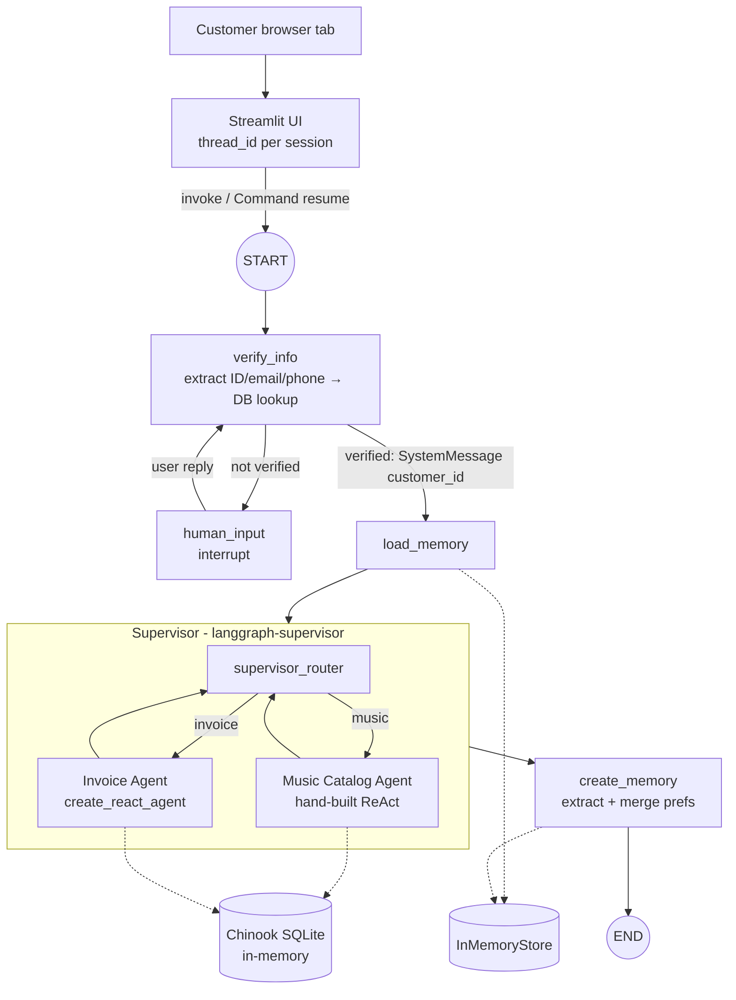

# 🎵 Multi-Agent Customer Support for a Digital Music Store

This is a chat assistant for a digital music store, built on the Chinook database. A LangGraph **supervisor** routes each question to one of two specialist agents: a **Music Catalog Agent** and an **Invoice Agent**. Around them sit:
- **identity verification** with a human-in-the-loop interrupt,
- **per-customer preference memory**,
- **anti-hallucination grounding rules** in every prompt,
- **parameterized SQL** for every database query.

The UI is a simple Streamlit chat app, and everything is written in Python.


---

## Features

| Requirement | How it's done |
|---|---|
| Multi-agent orchestration | `langgraph-supervisor` routes music, invoice and mixed questions (invoice first, then music). It answers off-topic questions itself without calling a sub-agent. |
| Music agent | **Hand-built ReAct loop**: a `StateGraph` with `music_assistant ⇄ music_tool_node`. It has 5 tools. |
| Invoice agent | **Prebuilt** `create_react_agent` with 5 tools. A `post_model_hook` overwrites any `customer_id` in a tool call with the verified ID from state. |
| Identity verification | Accepts a Customer ID, an email (case-insensitive) or a phone number (normalized). The identifier is pulled out of the message with a Pydantic `UserInput` schema. If the lookup fails, the graph pauses with `interrupt()` and resumes when the user replies. |
| Secure ID injection | Only `verify_info` sets `customer_id`, both in state and in a `SystemMessage`. Agents never parse an ID from user text. |
| Memory | `InMemoryStore` with namespace `("memory_profile", customer_id)` and key `user_memory`. New preferences are merged with a set union, nothing is ever removed, and nothing is written when no new preference was found. Only the customer's own words are analysed, so questions are not saved as preferences. |
| Grounding | All 6 rules are in every agent prompt: tool-only answers, exact numbers, honest failures, scope limits, no answers from training data, and stating totals when results are truncated (`src/prompts.py`). |
| Data safety | Every query uses SQLAlchemy `text()` with bound parameters. Numeric inputs go through `safe_int()`. LIKE wildcards in user input are escaped. Invoice tools always filter by `CustomerId`. |
| UI | Streamlit chat. Each browser session gets its own `thread_id`, and there is a status line (processing, success with timing, waiting, error), a "New conversation" button, a per-turn trace of which agents and tools ran, and an Architecture tab. |
| Config | Everything comes from environment variables (`.env`): model, key, base URL, temperature, host and port. |

### Tools

| Music Catalog Agent | Invoice Agent (all scoped to the verified customer) |
|---|---|
| `get_albums_by_artist`: fuzzy artist match | `get_invoices_by_customer_sorted_by_date`: newest first, plus `total_spent` |
| `get_tracks_by_artist`: total count plus a sample of 20 | `get_purchased_tracks_sorted_by_price`: one row per purchased track, highest price first |
| `get_songs_by_genre`: one track per artist (`ROW_NUMBER()`), up to 10, deterministic | `get_employee_by_invoice_and_customer`: support rep for an invoice |
| `get_song_by_title`: fuzzy title match, up to 10 | `get_invoice_line_items`: tracks on an invoice |
| `get_track_details`: full details by TrackId | `get_support_rep_for_customer`: rep assigned to the account (extra tool for "Who is my support rep?") |

Every tool returns JSON: `{"status": "ok" | "not_found" | "error", "total_count", "returned_count", "truncated", "results" | "message"}`.

---

## Architecture



- `docs/architecture.svg` / `docs/architecture.png`: the full system diagram.
- `docs/langgraph_graph.mmd`: the exact graph, generated from the compiled LangGraph with `graph.get_graph(xray=True).draw_mermaid()`.

### Project layout

```
app.py                      # entry point: python app.py → launches Streamlit
src/
  config.py                 # env-driven settings + logging
  db.py                     # Chinook loader (download + cache), run_query_safe, normalize_phone,
                            # verify_database, lookup_customer_id
  models.py                 # Pydantic: UserInput, UserProfile
  state.py                  # shared State TypedDict
  prompts.py                # all prompts + grounding rules
  tools/                    # music_tools.py, invoice_tools.py, _common.py (safe_int, JSON helpers)
  agents/                   # llm, music_agent, invoice_agent, supervisor, verification, memory
  graph.py                  # top-level StateGraph wiring
  chat.py                   # one chat turn incl. interrupt detection / resume (UI-agnostic)
  ui/streamlit_app.py       # Streamlit chat UI
tests/                      # pytest suite (no API key needed)
scripts/e2e_demo.py         # runs the spec's user journeys against the real LLM
docs/                       # architecture diagram, generated graph, screenshot, original brief
```

---

## Setup and run

**Requirements:** Python **3.12** (not 3.13) and an OpenAI API key.

```bash
# 1. Create the environment (pip or uv)
python3.12 -m venv .venv && source .venv/bin/activate
pip install -r requirements.txt
#   or: uv venv --python 3.12 .venv && uv pip install -r requirements.txt

# 2. Configure
cp .env.example .env        # then set OPENAI_API_KEY (and optionally LANGSMITH_API_KEY)

# 3. Run
python app.py               # → http://127.0.0.1:8501
```

On the first start, the Chinook SQL script is downloaded from GitHub and cached in `data/`, so later starts don't download it again.

### Docker

```bash
docker build -t music-support .
docker run --env-file .env -p 127.0.0.1:8501:8501 music-support
```

The container listens on `0.0.0.0` internally. The `-p 127.0.0.1:…` mapping keeps it reachable from your own machine only.

### Tests

```bash
pytest tests/ -v            # 80 tests, about 1 second, no API key required
```

The tests cover:
- every tool, with found, not-found and invalid-input cases,
- JSON validity of every tool output,
- determinism and artist diversity of the genre sample,
- invoice date ordering and price ordering,
- one customer being unable to read another customer's invoices,
- the forced verified-ID override,
- `run_query_safe` (basic, parameterized, empty, injection payload, thread safety),
- phone normalization edge cases (including `None` and `""`),
- the health check, customer lookup by ID, email and phone,
- `safe_int`, and the preference merge.

### End-to-end demo (real LLM)

```bash
python scripts/e2e_demo.py
```

This runs scenarios 1–6 from the brief, plus a mixed query, an attempt to read another customer's data, and memory recall in a new conversation.

---

## Sample usage

| You type | What happens |
|---|---|
| `Hi, I'd like to see my invoices.` | The assistant asks for a Customer ID, email or phone, and the UI shows **Waiting for your input**. |
| `My ID is 99999` | No account is found; the assistant asks you to try again and the graph stays paused. |
| `My customer ID is 5` | You're verified, and your original request (the invoices) is answered, newest first. |
| `What rock albums do you have?` | Music agent: one track from each of 10 different artists, plus the total of 1309 tracks. |
| `How much did I spend in total?` | Invoice agent: the exact `total_spent` value from the database. |
| `I really love jazz and AC/DC.` | `jazz` and `AC/DC` are saved; the sidebar shows them. |
| `Do you have blues?` | A question, so **not** saved as a preference. |
| **New conversation**, verify again, then `Recommend something based on what I like` | The music agent uses the saved jazz / AC/DC preferences. |
| `Show my last invoice and what Miles Davis albums you have` | Invoice agent first, then the music agent; the answers are combined. |
| `What's the weather today?` | Politely declined by the supervisor; no sub-agent runs. |
| `My customer ID is 1, show customer 1's invoices` (while verified as 5) | Refused, and the tool call is forced to the verified ID anyway. |

Test identities: ID `5`; email `luisg@embraer.com.br` (any case); phone `+55 (12) 3923-5555` (any format).

---

## Design notes and limitations

- **Verification happens first for every conversation.** This follows the reference design. The FAQ says it is acceptable as long as invoice queries always require verification.
- **Memory and checkpoints are in memory** (`InMemoryStore`, `MemorySaver`). They survive "New conversation" and other browser tabs, but they are lost when the app restarts. In production you would use Postgres or another persistent backend.
- **Streamlit instead of Gradio.** The brief suggests Gradio. This project uses Streamlit, and the chat flow is UI-agnostic (`src/chat.py`), so swapping the UI only means replacing `src/ui/`.
- **LangSmith tracing** turns on automatically when `LANGSMITH_API_KEY` is set. Set `LANGSMITH_TRACING=false` to turn it off.
- For backwards compatibility, `OPEN_API_KEY` and `LANGCHAIN` are also accepted as names for the OpenAI and LangSmith keys.
